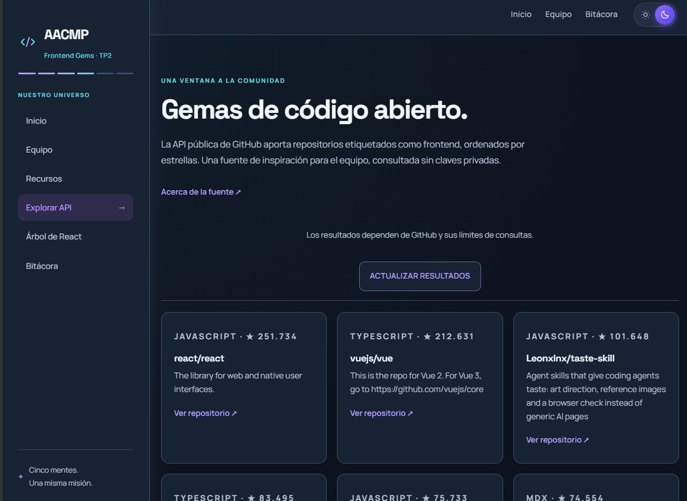
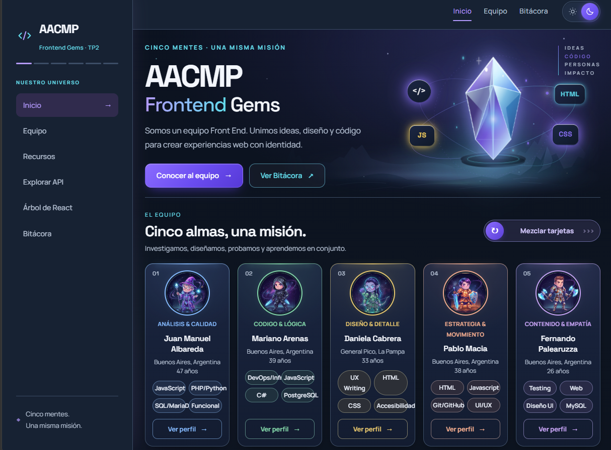
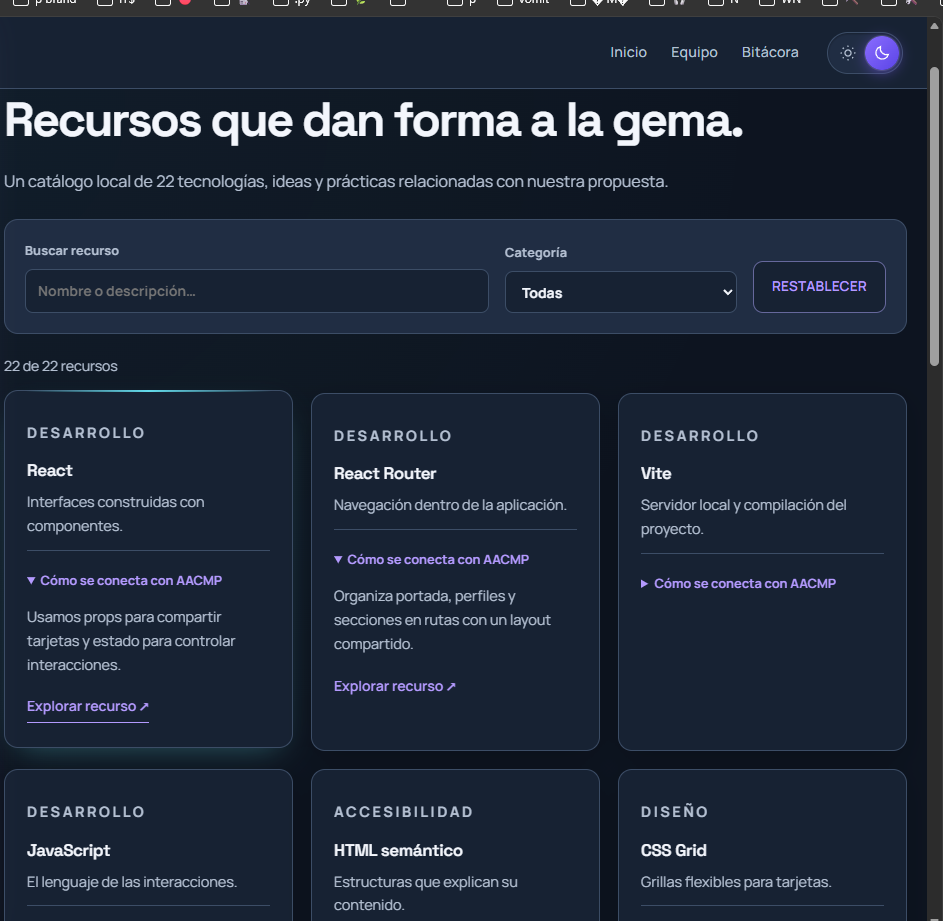

# AACMP · Frontend Gems · TP2

AACMP presenta a cinco integrantes que combinan análisis, desarrollo, diseño y contenido. Esta aplicación continúa el TP1 con componentes React y React Router, conservando el diseño de [la aplicación original](https://tp1-dswf-aacmp.vercel.app/index.html): cabecera superior, gema SVG animada, degradados violetas y cian, fondos ilustrados, tarjetas compactas y avatares con variantes claras y oscuras.

## Índice

- [El equipo](#el-equipo)
- [Cómo ejecutar](#cómo-ejecutar)
- [Secciones](#secciones)
- [Arquitectura](#arquitectura)
- [Uso de IA](#uso-de-ia)
- [Estado de la entrega](#estado-de-la-entrega)

## Enlaces del proyecto

- [Deploy en Vercel](https://tp2-dswf.vercel.app/)
- [Repositorio TP2](https://github.com/pablormacia/TP2-DSWF-AACMP)

## El equipo

| Integrante           | GitHub                                                      | Perfil (TP1)            | Responsabilidad en el TP2                                                                                                   |
| -------------------- | ----------------------------------------------------------- | ----------------------- | --------------------------------------------------------------------------------------------------------------------------- |
| Juan Manuel Albareda | [juanmanuelalbareda](https://github.com/juanmanuelalbareda) | Análisis y calidad      | Sidebar fija en escritorio, isotipo compartido, árbol y bitácora actualizados; revisión contra la rúbrica y declaración de IA |
| Mariano Arenas       | [NanoCode10](https://github.com/NanoCode10)                 | Código y lógica         | Navegación y sidebar, búsqueda y filtro de recursos como funciones puras, pruebas automatizadas, contraste de la bitácora    |
| Daniela Cabrera      | [Dancay5071](https://github.com/Dancay5071)                 | Diseño y detalle        | Estilos de la navegación lateral y responsive; perfiles unificados en un componente reutilizable y desplazamiento a `#equipo` |
| Pablo Macia          | [pablormacia](https://github.com/pablormacia)               | Estrategia y movimiento | Creación del repositorio, migración del TP1 a React (rutas, páginas, datos, API, árbol y bitácora) y deploy en Vercel        |
| Fernando Palearuzza  | [FerPalearuzza](https://github.com/FerPalearuzza)           | Contenido y empatía     | Capturas del proyecto y revisión del README                                                                                 |

## Cómo ejecutar

Requiere Node.js 20.19+ o 22.12+ y npm.

```bash
npm ci
npm run dev
npm run build
npm run preview
npm test
```

En PowerShell, si la política impide ejecutar `npm.ps1`, usar `npm.cmd` para estos comandos.

Vercel: importar el repositorio como proyecto Vite, compilar con `npm run build` y publicar `dist`. `vercel.json` configura el fallback a `index.html` para abrir y recargar rutas directamente.

## Secciones

| Ruta          | Contenido e interacciones                                                                                                               |
| ------------- | --------------------------------------------------------------------------------------------------------------------------------------- |
| `/`           | Presentación del equipo, cinco tarjetas y mezcla del orden                                                                              |
| `/equipo`     | Acceso al equipo desde la sidebar                                                                                                       |
| `/equipo/:id` | Perfiles de juan, mariano, daniela, pablo y fernando; revelado de retrato y cambio de tono por habilidad                                |
| `/recursos`   | 22 registros de JSON local, búsqueda sin distinción de mayúsculas o tildes, filtro por categoría, detalles, contador y restablecimiento |
| `/explorar`   | API pública de GitHub: repositorios frontend, descripción, lenguaje y estrellas; carga, error, timeout y actualización o reintento      |
| `/arbol`      | Jerarquía real de componentes, con nodos expandibles                                                                                    |
| `/bitacora`   | Registros del TP1 y de la migración a TP2, desplegables y filtro por etapa                                                              |

La sidebar compartida muestra la identidad del equipo e identifica la sección activa. Desde 1200 px queda fija a la izquierda y el contenido se ubica a su lado; en pantallas menores se abre como un panel superpuesto mediante el botón ☰ y se cierra por botón, fondo o Escape. El tema se guarda localmente y adapta los avatares. Las rutas anteriores `.html` redirigen a las pantallas React.

La API utiliza [GitHub Search Repositories](https://docs.github.com/en/rest/search/search#search-repositories), sin tokens ni claves privadas. Puede limitar consultas anónimas; la interfaz muestra el error y permite reintentar. Los recursos locales no dependen de la API.

## Arquitectura

- `src/App.jsx`: rutas; `src/components/NotFound.jsx`: pantalla de enlace inexistente.
- `src/components/Layout.jsx`: layout persistente, Header, Sidebar y Outlet.
- `src/components/MemberCard.jsx`: tarjetas originales reutilizadas mediante props.
- `src/components/ThemedImage.jsx`: imágenes que responden al tema y al revelado.
- `src/components/MemberSheet.jsx` y `ShuffleControl.jsx`: ficha móvil y mezclador por click o arrastre.
- `src/components/Footer.jsx`: footer original según la página.
- `src/pages/`: portada, perfiles, recursos, API, árbol y bitácora.
- `src/data/`: integrantes, 22 recursos y registros del proceso.
- `src/lib/`: `github.js` consulta la API y valida su respuesta; `resources.js` resuelve la búsqueda y el filtro de recursos como funciones puras.
- `public/css/`: los estilos originales del TP1, idénticos a los del sitio de referencia.
- `src/styles.css`: estilos acotados al panel lateral y a las secciones nuevas del TP2.

Las pantallas se construyen con JSX y estado/hooks de React. El HTML serializado y los scripts del TP1 se conservan como referencia en `src/pages.json` y `public/js/`; la aplicación nueva no los importa ni ejecuta. Las capturas preexistentes en `public/docs/capturas/` corresponden al TP1.

Validación local: compilación de producción; 14 pruebas automatizadas con `node:test`: seis de la API (consulta sin credenciales, límites, respuestas inválidas incluida `null`, resultado vacío y errores) y ocho de los recursos (búsqueda por nombre, mayúsculas y tildes, categoría, combinación, sin resultados, restablecimiento, espacios y catálogo local); revisión en navegador de los cinco perfiles, búsqueda y filtro combinados, bitácora, árbol desplegable, tema y menú móvil a 390 px. La API devolvió nueve repositorios en la consulta real.

## Uso de IA

La tabla diferencia la aplicación o entorno desde el que se trabajó del modelo empleado. Hay una fila por herramienta: quien usó más de una tiene varias.

| Integrante           | Aplicación                         | Modelo                              | Contenido o tarea                                                                                                                                                   |
| -------------------- | ---------------------------------- | ----------------------------------- | ------------------------------------------------------------------------------------------------------------------------------------------------------------------- |
| Pablo Macia          | OpenAI Codex                       | GPT-6                               | Lectura de la consigna, migración a componentes React, sidebar, datos locales, filtros, API, árbol, bitácora, estilos y revisión                                    |
| Daniela Cabrera      | Google Antigravity (IDE)           | Gemini 3.8 Flash, Claude Sonnet 4.6 | Resolución del bug de navegación y desplazamiento suave hacia la sección `#equipo` desde la sidebar y el header                                                     |
| Juan Manuel Albareda | Claude Code (extensión de VS Code) | Claude Opus 5.5                     | Sidebar fija en escritorio con panel en móvil, isotipo compartido (`BrandMark`), árbol y bitácora actualizados, documentación y declaración de uso de IA            |
| Mariano Arenas       | Claude Code (CLI)                  | Claude Opus 5.5                     | Coordinación: auditoría de los 15 criterios, enlace `Equipo` con desplazamiento a la sección, indicador de progreso de la sidebar, revisión responsive en navegador |
| Mariano Arenas       | OpenAI Codex (CLI)                 | GPT-6-Sol                           | Implementación: lógica de búsqueda y filtro de recursos como función pura, sus tests y el manejo de una respuesta `null` de la API                                  |
| Mariano Arenas       | OpenCode                           | DeepSeek V4.1 Flash Free            | Testing: revisión independiente de los criterios, del deploy y de los cambios anteriores                                                                            |
| Fernando Palearuzza  | GitHub Copilot                     | GPT-6 Luna                          | Chequeo del repositorio y del código, ajustes finales                                                                                                               |

Mariano trabajó con [Herdr](https://herdr.dev) como orquestador: no es un modelo, sino el entorno de terminal que coordina a los tres agentes. Claude Code distribuyó las tareas, Codex implementó y OpenCode revisó de forma independiente; cada cambio se verificó con tests, compilación y pruebas en navegador.

## Estado de la entrega

Implementadas las funcionalidades de los criterios 4 a 14. La documentación identifica los cinco integrantes y, para cada uno, la aplicación, el modelo y la tarea en que usó IA (criterio 15).

El deploy de Vercel y el repositorio independiente de TP2 están enlazados arriba. Ambos son de acceso público, y los cinco integrantes tienen aceptada la invitación como colaboradores del repositorio.


## Capturas

Se muestran las capturas de los módulos incorporados en esta entrega.

### Exploración de la API



### Menú desplegable: 




### Página de recursos con formulario y links   ,


